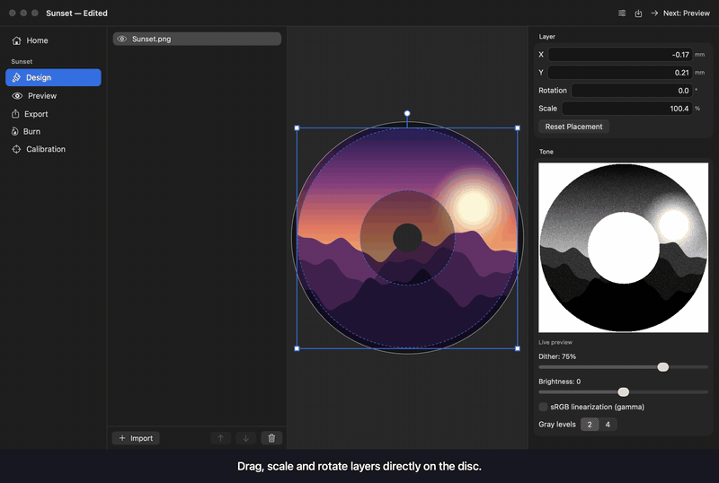
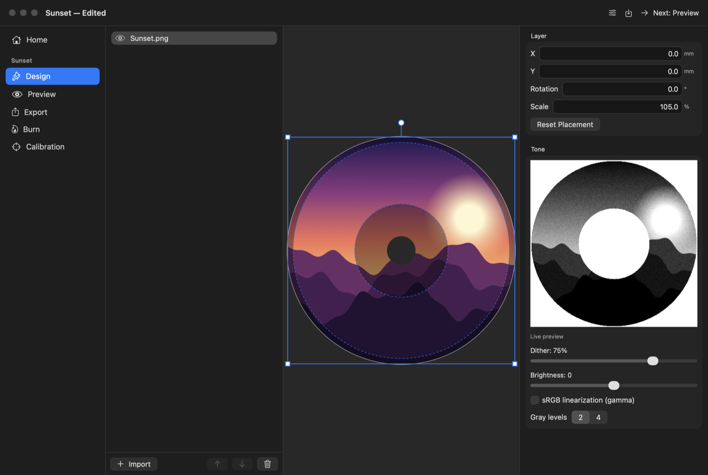
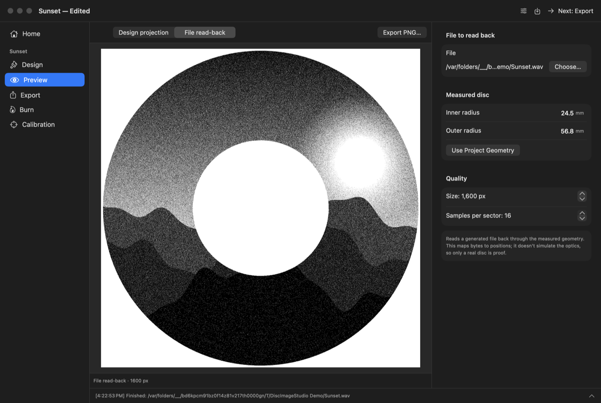
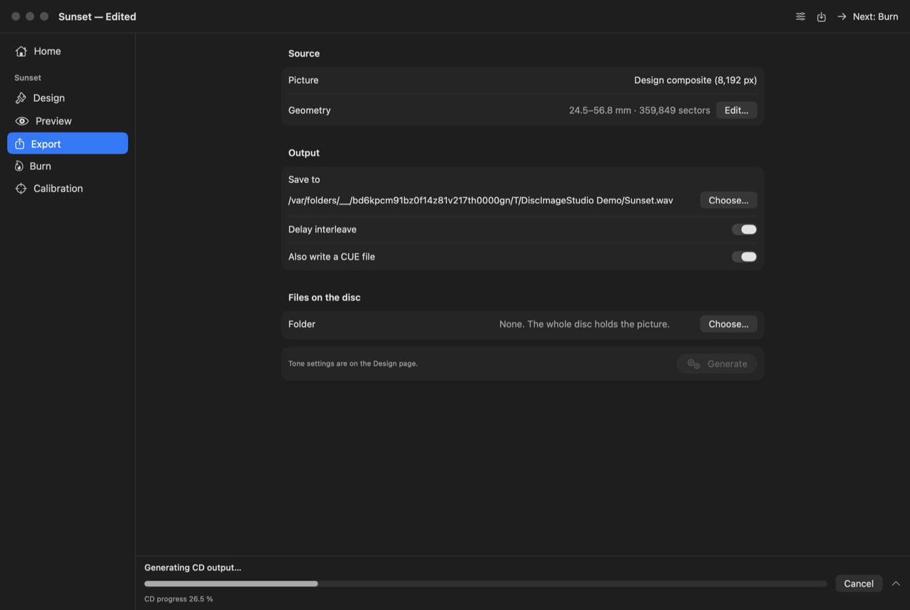
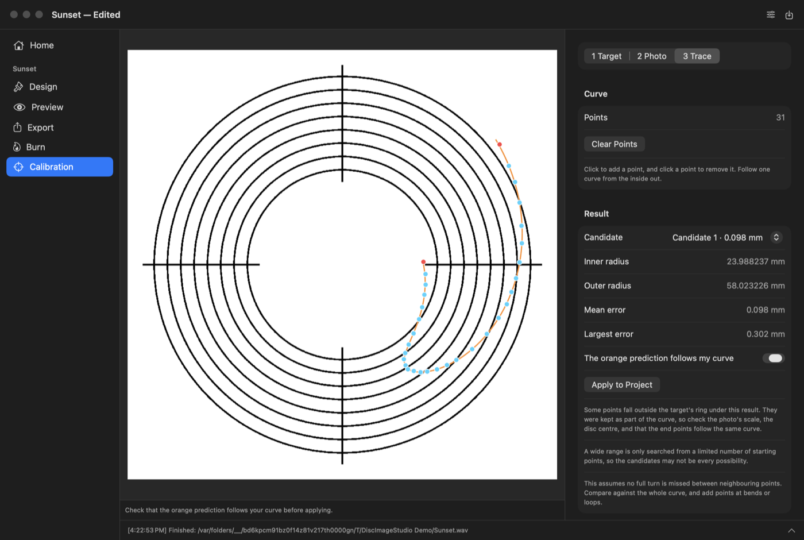

# Disc Image Studio for Mac

**Turn a picture into a CD, DVD or Blu-ray image whose data draws that picture on the disc, from a native Mac app.**

[](docs/media/demo.mp4)

**[▶ Watch the full 70-second demo (MP4)](docs/media/demo.mp4)**

> **About this demo:** a script drove the app's real pages and the real engine in an off-screen window, so it's a rendered walkthrough, not a recording of someone using the app. The generated CD track, previews and calibration result are all real. The title bar and sidebar around the pages are redrawn, because macOS can't draw its window materials off-screen. Pointer movement isn't shown.

> [!WARNING]
> This is an experimental fork feature. **Burning has only been confirmed on DVD-R, on one drive**, and the app hasn't yet had a full hands-on pass in its live window. See [what's been tested](#whats-been-tested).

Disc Image Studio started as a [Windows app by JiaFeiMiao-K-Cat](https://github.com/JiaFeiMiao-K-Cat/DiscImageStudio) with an experimental command-line version for macOS. This app puts a SwiftUI interface on that same engine, so a disc image made here comes from the same generation code as one made on Windows.

## How it works

### 1. Design the disc

Import pictures as layers, then drag, scale and rotate them on the disc. The Tone panel shows what the disc will really look like, rendered by the engine as you change dither, brightness and gamma.



### 2. Preview it

Project your design through the disc's spiral track. Enter a real disc's measured radii, and any mismatch shows up before you use a disc. You can also read a generated file back to check its contents.



### 3. Export it

Write WAV + CUE, RAW or ISO files, with live progress and cancel. You can also put a folder of files on the disc alongside the picture.



### 4. Calibrate to your discs

Every disc model differs slightly. Burn a known target, photograph the disc, trace the curve that appears, and the engine fits that disc's real geometry so your pictures line up.



Some discs already have a measured template. **Fujifilm DVD-R ProdiscF02** was burned at 4x on a TEAC DV-W28S-VT and checked from photos of the real disc. Give your picture a solid background with this template, because transparent areas aren't written and the picture comes out much fainter.

### 5. Burn it

The Burn page writes disc images through Apple's DiscRecording framework, and CD audio through `drutil`. It starts with a laser-off test burn selected, and asks before writing anything. Read [the differences from Windows](#differences-from-the-windows-app) first.

## Get started

You need macOS 14 or later, Xcode's command line tools and the [.NET 10 SDK](https://dotnet.microsoft.com/download/dotnet/10.0). There's no download yet, so build it from this folder (`src/DiscImageStudio.Mac`):

```bash
scripts/build-app.sh
```

```bash
open "dist/Disc Image Studio.app"
```

The script bundles the engine into the app, so nothing else needs installing to run it. It builds for your Mac's architecture, or pass `osx-arm64` or `osx-x64` to choose. The app is signed for local use only, so other Macs will warn about it until it's signed with a Developer ID and notarized.

## What's been tested

| Area | Status | How |
| --- | --- | --- |
| CD, DVD and Blu-ray generation | ✅ Tested | Small test discs through the real engine, plus one full 80-minute CD track |
| Previews and read-back | ✅ Tested | Real engine output for all three disc types |
| Calibration fit | ✅ Tested | Reproduces the published answer for the repo's real traced Blu-ray curve, and recovers known radii on synthetic discs |
| Project files | ✅ Tested | Files saved here pass the engine's project validator, the same code Windows loads them with |
| Cancelling | ✅ Tested | A real Blu-ray job stops promptly and leaves no finished-looking file |
| Page layout | ✅ Rendered | Pages rendered off-screen and checked by eye |
| Clicking through the live app | ⚠️ Not yet | Dragging, file dialogs and the real title bar and sidebar need a hands-on pass |
| Burning | ⚠️ DVD-R only | Picture-only DVD-Rs burned at 4x on a TEAC DV-W28S-VT with **Verify** off, since its check can report a false failure. CD and Blu-ray burning are untested |
| Windows build after this work | ⚠️ Partly | The Blu-ray preview moved to shared code. The Windows app and its tests compile from a Mac using .NET's Windows targeting, but that skips the Windows image code, and nothing has run on Windows |

## Differences from the Windows app

- **Burning:** Windows controls the burner through IMAPI2, and this app uses DiscRecording, so results may differ. Images are written to a file first, so a Blu-ray needs about 25 GB free. Images are written disc-at-once from the file's exact bytes, because `hdiutil burn` refuses picture-only images or replaces them with a new filesystem. On audio discs macOS adds its own track gap and the drive can't be chosen, so the picture may not line up.
- **Language:** the interface is English only, where Windows also has Chinese, Japanese and Turkish.
- **Layer compositing:** this is a Core Graphics rewrite of the Windows composer. Placement follows the same rules, but image scaling isn't pixel-identical.

Project files (`.discproj`) and calibration records use the same formats on both platforms. A project's image paths are absolute, so images need re-linking if they move.

## For developers

```text
Sources/DiscImageStudioKit   Project files, CLI arguments, compositing and burn commands, with no UI
Sources/DiscImageStudioMac   The SwiftUI app
Catalogs                     English for engine messages the Windows catalogs don't cover
Tests                        Unit, engine and page tests, plus the demo renderer
scripts                      build-app.sh and render-demo.sh
../DiscImageStudio.Cli/GuiBridge.cs   gui-* commands for engine features the Windows app calls in process
```

The app runs the engine as a separate process. Most `gui-*` commands print one JSON document, and failures come back as an `error:` line on stderr with a non-zero exit. Setting `DISC_IMAGE_STUDIO_JSON_PROGRESS=1` makes generation commands print `@@dis-progress {json}` lines.

### Run the tests

Without extra settings, tests that need the engine are skipped:

```bash
swift test
```

To include them, build the app first and point at its engine. Setting the snapshots folder also renders every page there:

```bash
DISC_IMAGE_STUDIO_CLI="$PWD/dist/Disc Image Studio.app/Contents/Resources/cli/disc-image-studio" DISC_IMAGE_STUDIO_SNAPSHOTS="$PWD/.build/pages" swift test
```

### Rebuild the demo

This also needs `ffmpeg`. It temporarily uses about 2 GB, shows nothing on screen, and writes to `docs/media`:

```bash
scripts/render-demo.sh
```

The script's steps are in [DemoVideoTests.swift](Tests/DiscImageStudioMacTests/DemoVideoTests.swift). It fails if the generated track is the wrong size, or the calibration result differs from the published answer.

## License

GPL-3.0-or-later, the same as the rest of the project. See [LICENSE](../../LICENSE) and [the license notice](../../LICENSE-NOTICE.md). If you distribute a build, the GPL requires you to offer the matching source. The app bundles the license and third-party notices.
